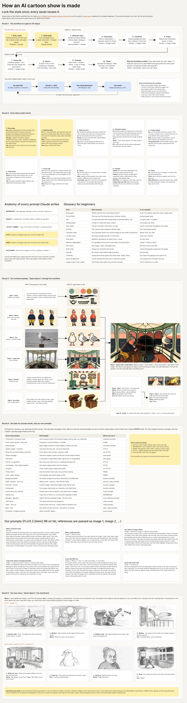
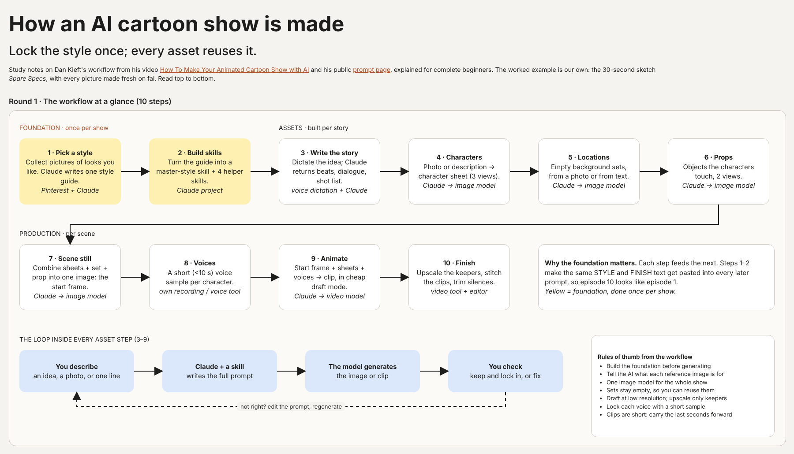
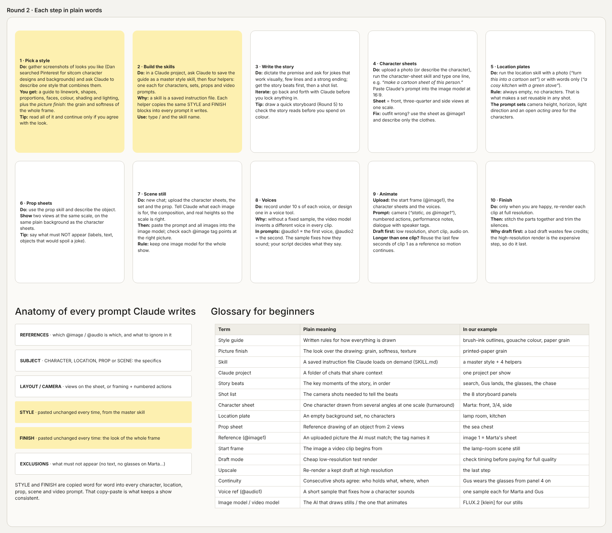
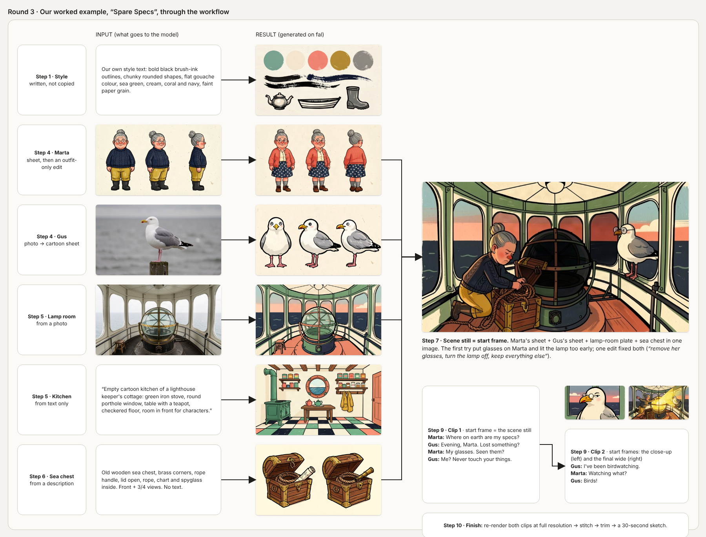
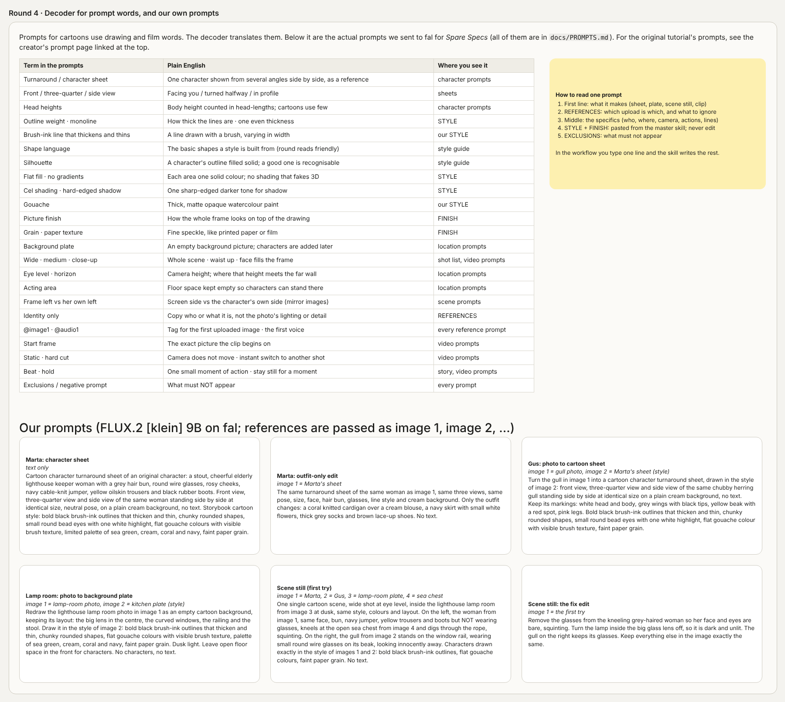
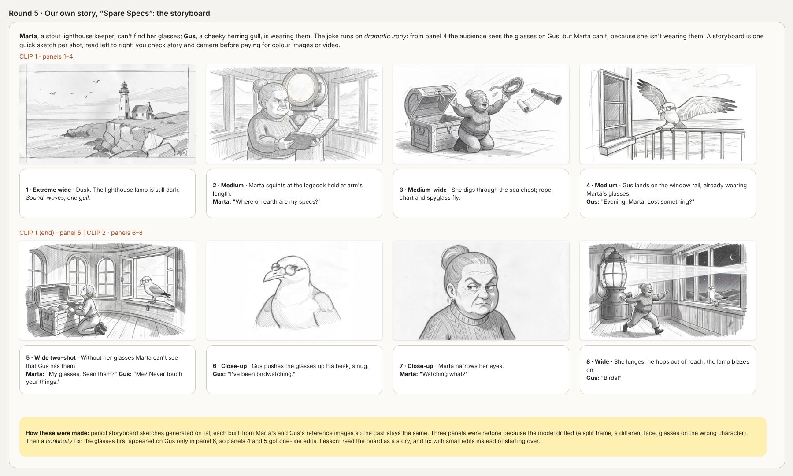

# How an AI cartoon show is made: a beginner's guide

> **Lock the style once; every asset reuses it.**

Study notes on the workflow Dan Kieft teaches in his video [How To Make Your Animated Cartoon Show with AI](https://www.youtube.com/watch?v=ZRUpbbZF0_A) and his public [prompt page](https://cartoon-show-site.vercel.app/): style guide, Claude skills, story, character sheets, sets, props, voices and animation. Written for someone with no animation or art background, with a decoder for the drawing and film vocabulary.

The worked example is **our own**: *Spare Specs*, a 30-second sketch about a lighthouse keeper whose glasses have been borrowed by a gull. Its story, characters, prompts and all 20 pictures were made for this repo on [fal](https://fal.ai). This repo contains **no** prompts, transcript text, story, characters or images from the tutorial; go to the links above for those (see [NOTICE](NOTICE) and the [development journey](docs/DEVELOPMENT_JOURNEY.md)).

Companion repos, same approach: [ai-commercial-workflow-guide](https://github.com/az9713/ai-commercial-workflow-guide), [cinematic-ai-ad-workflow-guide](https://github.com/az9713/cinematic-ai-ad-workflow-guide), [ai-animation-workflow-guide](https://github.com/az9713/ai-animation-workflow-guide).

## Watch *Spare Specs* (21 s, with sound)

https://github.com/user-attachments/assets/16f5eb23-2333-4f81-8cc5-5cfe9236a2a9

Also in the repo as [`video/spare-specs.mp4`](video/spare-specs.mp4) (2.8 MB). Three clips from Wan 3.0 Prime on fal, each starting on one of the stills in Round 3, with voices and sound generated by the model; prompts in [docs/PROMPTS.md](docs/PROMPTS.md#the-video-clips).

## Open it

Download or clone the repo and open **`index.html`** in a browser: one page with a tab per section, a zoomable "Whole board" tab, and images that open full size on click. GitHub shows `.html` files as code, so open it locally.

## The board at a glance

Each section below shows its tab as an image, with a searchable text version folded underneath.

## Round 1 · The workflow at a glance (10 steps)

Text version

FOUNDATION · once per show

ASSETS · built per story

**1 · Pick a style**  
Collect pictures of looks you like. Claude writes one style guide.  
*Pinterest + Claude*

**2 · Build skills**  
Turn the guide into a master-style skill + 4 helper skills.  
*Claude project*

**3 · Write the story**  
Dictate the idea; Claude returns beats, dialogue, shot list.  
*voice dictation + Claude*

**4 · Characters**  
Photo or description → character sheet (3 views).  
*Claude → image model*

**5 · Locations**  
Empty background sets, from a photo or from text.  
*Claude → image model*

**6 · Props**  
Objects the characters touch, 2 views.  
*Claude → image model*

PRODUCTION · per scene

**7 · Scene still**  
Combine sheets + set + prop into one image: the start frame.  
*Claude → image model*

**8 · Voices**  
A short (<10 s) voice sample per character.  
*own recording / voice tool*

**9 · Animate**  
Start frame + sheets + voices → clip, in cheap draft mode.  
*Claude → video model*

**10 · Finish**  
Upscale the keepers, stitch the clips, trim silences.  
*video tool + editor*

**Why the foundation matters.** Each step feeds the next. Steps 1–2 make the same STYLE and FINISH text get pasted into every later prompt, so episode 10 looks like episode 1.  
*Yellow = foundation, done once per show.*

THE LOOP INSIDE EVERY ASSET STEP (3–9)

**Rules of thumb from the workflow**
- Build the foundation before generating
- Tell the AI what each reference image is for
- One image model for the whole show
- Sets stay empty, so you can reuse them
- Draft at low resolution; upscale only keepers
- Lock each voice with a short sample
- Clips are short: carry the last seconds forward

**You describe**  
an idea, a photo, or one line

**Claude + a skill**  
writes the full prompt

**The model generates**  
the image or clip

**You check**  
keep and lock in, or fix

## Round 2 · Each step in plain words

Text version

**1 · Pick a style**  
**Do:** gather screenshots of looks you like (Dan searched Pinterest for sitcom character designs and backgrounds) and ask Claude to describe *one* style that combines them.  
**You get:** a guide to linework, shapes, proportions, faces, colour, shading and lighting, plus the *picture finish*: the grain and softness of the whole frame.  
**Tip:** read all of it and continue only if you agree with the look.

**2 · Build the skills**  
**Do:** in a Claude project, ask Claude to save the guide as a master style skill, then four helpers: one each for characters, sets, props and video prompts.  
**Why:** a skill is a saved instruction file. Each helper copies the same STYLE and FINISH blocks into every prompt it writes.  
**Use:** type / and the skill name.

**3 · Write the story**  
**Do:** dictate the premise and ask for jokes that work visually, few lines and a strong ending; get the story beats first, then a shot list.  
**Iterate:** go back and forth with Claude before you lock anything in.  
**Tip:** draw a quick storyboard (Round 5) to check the story reads before you spend on colour.

**4 · Character sheets**  
**Do:** upload a photo (or describe the character), run the character-sheet skill and type one line, e.g. *“make a cartoon sheet of this person.”* Paste Claude's prompt into the image model at 16:9.  
**Sheet** = front, three-quarter and side views at one scale.  
**Fix:** outfit wrong? use the sheet as @image1 and describe only the clothes.

**5 · Location plates**  
**Do:** run the location skill with a photo (*“turn this into a cartoon set”*) or with words only (*“a cosy kitchen with a green stove”*).  
**Rule:** always empty, no characters. That is what makes a set reusable in any shot.  
**The prompt sets** camera height, horizon, light direction and an open *acting area* for the characters.

**6 · Prop sheets**  
**Do:** use the prop skill and describe the object.  
**Show** two views at the same scale, on the same plain background as the character sheets.  
**Tip:** say what must NOT appear (labels, text, objects that would spoil a joke).

**7 · Scene still**  
**Do:** new chat; upload the character sheets, the set and the prop. Tell Claude what each image is for, the composition, and real heights so the scale is right.  
**Then:** paste the prompt and all images into the image model; check each @image tag points at the right picture.  
**Rule:** keep one image model for the whole show.

**8 · Voices**  
**Do:** record under 10 s of each voice, or design one in a voice tool.  
**Why:** without a fixed sample, the video model invents a different voice in every clip.  
**In prompts:** @audio1 = the first voice, @audio2 = the second. The sample fixes how they sound; your script decides what they say.

**9 · Animate**  
**Upload:** the start frame (@image1), the character sheets and the voices.  
**Prompt:** camera (*“static, as @image1”*), numbered actions, performance notes, dialogue with speaker tags.  
**Draft first:** low resolution, short clip, audio on.  
**Longer than one clip?** Reuse the last few seconds of clip 1 as a reference so motion continues.

**10 · Finish**  
**Do:** only when you are happy, re-render each clip at full resolution.  
**Then:** stitch the parts together and trim the silences.  
**Why draft first:** a bad draft wastes few credits; the high-resolution render is the expensive step, so do it last.

Anatomy of every prompt Claude writes

Glossary for beginners

**REFERENCES** · which @image / @audio is which, and what to ignore in it

| Term | Plain meaning | In our example |
|---|---|---|
| Style guide | Written rules for how everything is drawn | brush-ink outlines, gouache colour, paper grain |
| Picture finish | The look over the drawing: grain, softness, texture | printed-paper grain |
| Skill | A saved instruction file Claude loads on demand (SKILL.md) | a master style + 4 helpers |
| Claude project | A folder of chats that share context | one project per show |
| Story beats | The key moments of the story, in order | search, Gus lands, the glasses, the chase |
| Shot list | The camera shots needed to tell the beats | the 8 storyboard panels |
| Character sheet | One character drawn from several angles at one scale (turnaround) | Marta: front, 3/4, side |
| Location plate | An empty background set, no characters | lamp room, kitchen |
| Prop sheet | Reference drawing of an object from 2 views | the sea chest |
| Reference (@image1) | An uploaded picture the AI must match; the tag names it | image 1 = Marta's sheet |
| Start frame | The image a video clip begins from | the lamp-room scene still |
| Draft mode | Cheap low-resolution test render | check timing before paying for full quality |
| Upscale | Re-render a kept draft at high resolution | the last step |
| Continuity | Consecutive shots agree: who holds what, where, when | Gus wears the glasses from panel 4 on |
| Voice ref (@audio1) | A short sample that fixes how a character sounds | one sample each for Marta and Gus |
| Image model / video model | The AI that draws stills / the one that animates | FLUX.2 [klein] for our stills |

**SUBJECT** · CHARACTER, LOCATION, PROP or SCENE: the specifics

**LAYOUT / CAMERA** · views on the sheet, or framing + numbered actions

**STYLE** · pasted unchanged every time, from the master skill

**FINISH** · pasted unchanged every time: the look of the whole frame

**EXCLUSIONS** · what must not appear (no text, no glasses on Marta…)

STYLE and FINISH are copied word for word into every character, location, prop, scene and video prompt. That copy-paste is what keeps a show consistent.

## Round 3 · Our worked example, “Spare Specs”, through the workflow

Text version

INPUT (what goes to the model)

RESULT (generated on fal)

**Step 1 · Style**  
written, not copied

Our own style text: bold black brush-ink outlines, chunky rounded shapes, flat gouache colour, sea green, cream, coral and navy, faint paper grain.

**Step 4 · Marta**  
sheet, then an outfit-only edit

**Step 4 · Gus**  
photo → cartoon sheet

**Step 5 · Lamp room**  
from a photo

**Step 7 · Scene still = start frame.** Marta's sheet + Gus's sheet + lamp-room plate + sea chest in one image. The first try put glasses on Marta and lit the lamp too early; one edit fixed both (*“remove her glasses, turn the lamp off, keep everything else”*).

**Step 5 · Kitchen**  
from text only

“Empty cartoon kitchen of a lighthouse keeper's cottage: green iron stove, round porthole window, table with a teapot, checkered floor, room in front for characters.”

**Step 9 · Clip 1** · start frame = the scene still  
**Marta:** Where on earth are my specs?  
**Gus:** Evening, Marta. Lost something?  
**Marta:** My glasses. Seen them?  
**Gus:** Me? Never touch your things.

**Step 9 · Clip 2** · start frames: the close-up (left) and the final wide (right)  
**Gus:** I've been birdwatching.  
**Marta:** Watching what?  
**Gus:** Birds!

**Step 6 · Sea chest**  
from a description

Old wooden sea chest, brass corners, rope handle, lid open, rope, chart and spyglass inside. Front + 3/4 views. No text.

**Step 10 · Finish:** re-render both clips at full resolution → stitch → trim → a 30-second sketch.

## Round 4 · Decoder for prompt words, and our own prompts

Text version

Prompts for cartoons use drawing and film words. The decoder translates them. Below it are the actual prompts we sent to fal for *Spare Specs* (all of them are in `docs/PROMPTS.md`). For the original tutorial's prompts, see the creator's prompt page linked at the top.

| Term in the prompts | Plain English | Where you see it |
|---|---|---|
| Turnaround / character sheet | One character shown from several angles side by side, as a reference | character prompts |
| Front / three-quarter / side view | Facing you / turned halfway / in profile | sheets |
| Head heights | Body height counted in head-lengths; cartoons use few | character prompts |
| Outline weight · monoline | How thick the lines are · one even thickness | STYLE |
| Brush-ink line that thickens and thins | A line drawn with a brush, varying in width | our STYLE |
| Shape language | The basic shapes a style is built from (round reads friendly) | style guide |
| Silhouette | A character's outline filled solid; a good one is recognisable | style guide |
| Flat fill · no gradients | Each area one solid colour; no shading that fakes 3D | STYLE |
| Cel shading · hard-edged shadow | One sharp-edged darker tone for shadow | STYLE |
| Gouache | Thick, matte opaque watercolour paint | our STYLE |
| Picture finish | How the whole frame looks on top of the drawing | FINISH |
| Grain · paper texture | Fine speckle, like printed paper or film | FINISH |
| Background plate | An empty background picture; characters are added later | location prompts |
| Wide · medium · close-up | Whole scene · waist up · face fills the frame | shot list, video prompts |
| Eye level · horizon | Camera height; where that height meets the far wall | location prompts |
| Acting area | Floor space kept empty so characters can stand there | location prompts |
| Frame left vs her own left | Screen side vs the character's own side (mirror images) | scene prompts |
| Identity only | Copy who or what it is, not the photo's lighting or detail | REFERENCES |
| @image1 · @audio1 | Tag for the first uploaded image · the first voice | every reference prompt |
| Start frame | The exact picture the clip begins on | video prompts |
| Static · hard cut | Camera does not move · instant switch to another shot | video prompts |
| Beat · hold | One small moment of action · stay still for a moment | story, video prompts |
| Exclusions / negative prompt | What must NOT appear | every prompt |

**How to read one prompt**
1. First line: what it makes (sheet, plate, scene still, clip)
2. REFERENCES: which upload is which, and what to ignore
3. Middle: the specifics (who, where, camera, actions, lines)
4. STYLE + FINISH: pasted from the master skill; never edit
5. EXCLUSIONS: what must not appear

In the workflow you type one line and the skill writes the rest.

Our prompts (FLUX.2 [klein] 9B on fal; references are passed as image 1, image 2, …)

**Marta: character sheet**  
*text only*  
Cartoon character turnaround sheet of an original character: a stout, cheerful elderly lighthouse keeper woman with a grey hair bun, round wire glasses, rosy cheeks, navy cable-knit jumper, yellow oilskin trousers and black rubber boots. Front view, three-quarter view and side view of the same woman standing side by side at identical size, neutral pose, on a plain cream background, no text. Storybook cartoon style: bold black brush-ink outlines that thicken and thin, chunky rounded shapes, small round bead eyes with one white highlight, flat gouache colours with visible brush texture, limited palette of sea green, cream, coral and navy, faint paper grain.

**Marta: outfit-only edit**  
*image 1 = Marta's sheet*  
The same turnaround sheet of the same woman as image 1, same three views, same pose, size, face, hair bun, glasses, line style and cream background. Only the outfit changes: a coral knitted cardigan over a cream blouse, a navy skirt with small white flowers, thick grey socks and brown lace-up shoes. No text.

**Gus: photo to cartoon sheet**  
*image 1 = gull photo, image 2 = Marta's sheet (style)*  
Turn the gull in image 1 into a cartoon character turnaround sheet, drawn in the style of image 2: front view, three-quarter view and side view of the same chubby herring gull standing side by side at identical size on a plain cream background, no text. Keep its markings: white head and body, grey wings with black tips, yellow beak with a red spot, pink legs. Bold black brush-ink outlines that thicken and thin, chunky rounded shapes, small round bead eyes with one white highlight, flat gouache colour with visible brush texture, faint paper grain.

**Lamp room: photo to background plate**  
*image 1 = lamp-room photo, image 2 = kitchen plate (style)*  
Redraw the lighthouse lamp room photo in image 1 as an empty cartoon background, keeping its layout: the big lens in the centre, the curved windows, the railing and the stool. Draw it in the style of image 2: bold black brush-ink outlines that thicken and thin, chunky rounded shapes, flat gouache colours with visible brush texture, palette of sea green, cream, coral and navy, faint paper grain. Dusk light. Leave open floor space in the front for characters. No characters, no text.

**Scene still (first try)**  
*image 1 = Marta, 2 = Gus, 3 = lamp-room plate, 4 = sea chest*  
One single cartoon scene, wide shot at eye level, inside the lighthouse lamp room from image 3 at dusk, same style, colours and layout. On the left, the woman from image 1, same face, bun, navy jumper, yellow trousers and boots but NOT wearing glasses, kneels at the open sea chest from image 4 and digs through the rope, squinting. On the right, the gull from image 2 stands on the window rail, wearing small round wire glasses on its beak, looking innocently away. Characters drawn exactly in the style of images 1 and 2: bold black brush-ink outlines, flat gouache colours, faint paper grain. No text.

**Scene still: the fix edit**  
*image 1 = the first try*  
Remove the glasses from the kneeling grey-haired woman so her face and eyes are bare, squinting. Turn the lamp inside the big glass lens off, so it is dark and unlit. The gull on the right keeps its glasses. Keep everything else in the image exactly the same.

## Round 5 · Our own story, “Spare Specs”: the storyboard

Text version

**Marta**, a stout lighthouse keeper, can't find her glasses; **Gus**, a cheeky herring gull, is wearing them. The joke runs on *dramatic irony*: from panel 4 the audience sees the glasses on Gus, but Marta can't, because she isn't wearing them. A storyboard is one quick sketch per shot, read left to right: you check story and camera before paying for colour images or video.

CLIP 1 · panels 1–4

**1 · Extreme wide** · Dusk. The lighthouse lamp is still dark. *Sound: waves, one gull.*

**2 · Medium** · Marta squints at the logbook held at arm's length.  
**Marta:** "Where on earth are my specs?"

**3 · Medium-wide** · She digs through the sea chest; rope, chart and spyglass fly.

**4 · Medium** · Gus lands on the window rail, already wearing Marta's glasses.  
**Gus:** "Evening, Marta. Lost something?"

CLIP 1 (end) · panel 5   |   CLIP 2 · panels 6–8

**5 · Wide two-shot** · Without her glasses Marta can't see that Gus has them.  
**Marta:** "My glasses. Seen them?" **Gus:** "Me? Never touch your things."

**6 · Close-up** · Gus pushes the glasses up his beak, smug.  
**Gus:** "I've been birdwatching."

**7 · Close-up** · Marta narrows her eyes.  
**Marta:** "Watching what?"

**8 · Wide** · She lunges, he hops out of reach, the lamp blazes on.  
**Gus:** "Birds!"

**How these were made:** pencil storyboard sketches generated on fal, each built from Marta's and Gus's reference images so the cast stays the same. Three panels were redone because the model drifted (a split frame, a different face, glasses on the wrong character). Then a *continuity* fix: the glasses first appeared on Gus only in panel 6, so panels 4 and 5 got one-line edits. Lesson: read the board as a story, and fix with small edits instead of starting over.

## Repo contents

- `index.html`: the board as one page with a tab per section; open locally in a browser
- `visuals/`: each tab rendered as a PNG
- `whiteboard/board.json`: the board data (positions, text, tables, arrows, image paths)
- `video/spare-specs.mp4`: the finished 21-second sketch, plus its poster image
- `images/`: the 20 original pictures (12 colour assets + 8 storyboard panels) and the first, flawed scene still kept as a lesson
- `docs/PROMPTS.md`: every prompt we sent to fal, image by image
- `docs/DEVELOPMENT_JOURNEY.md`: how this public version was made, including the fal pipeline and the fixes
- `tools/build.py` rebuilds `index.html`; `tools/shot.py` re-renders the PNGs (Playwright + Chrome); `tools/readme.py` regenerates this README

## Images

Every picture was generated for this repo with fal, using FLUX.2 [klein] 9B (text-to-image, and its edit endpoint when reference images are passed), from our own written prompts. No image from the tutorial was used as an input. The two photos (the gull and the lamp room) are AI-generated stand-ins that play the role of "a photo you took", so the photo-to-cartoon steps can be shown. Total cost was about 20 cents (29 jobs); the video added about $2.50.

## Credits and license

- Workflow taught by Dan Kieft ([video](https://www.youtube.com/watch?v=ZRUpbbZF0_A), [prompt page](https://cartoon-show-site.vercel.app/)). Go there for the original prompts, skills and example. Not affiliated with or endorsed by him or by any company named here.
- Notes, story, prompts and pictures: written and generated with Claude and fal for study.
- License: code (`tools/`, the HTML/JS) MIT; text and images CC BY 4.0. See [LICENSE](LICENSE) and [NOTICE](NOTICE).
